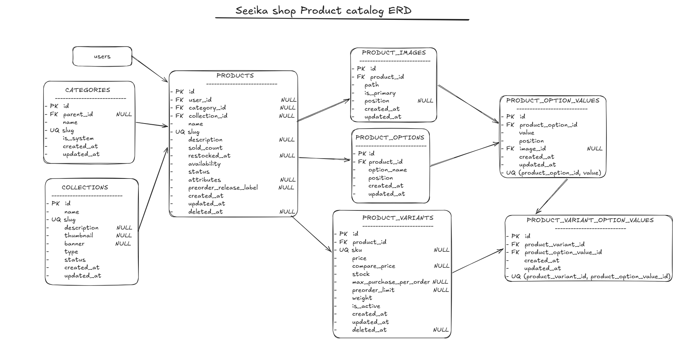

# Seeika Shop

An e-commerce website built with Laravel, Tailwind CSS, Alpine.js, and MySQL.

## Features

- Customer registration and login
- Admin authentication and dashboard
- Product listings and product detail pages
- Single products and products with multiple variants
- Product search powered by Laravel Scout and Meilisearch
- Shopping cart and checkout
- Customer addresses with Indonesian administrative regions
- Wishlist
- Ready-stock and pre-order products
- Variant-specific pricing, inventory, and purchase limits
- Product collections and categories
- Contact form with email delivery
- Address management with dependent regional dropdowns

## Tech Stack

- PHP
- Laravel 12
- MySQL
- Tailwind CSS
- Alpine.js
- Laravel Scout
- Meilisearch v1.49.0
- Laravolt Indonesia
- Vite
- Boxicons and SVG icons

## Icons

The project uses Boxicons and SVGs for its icons.

Boxicons is installed through npm and bundled with Vite. Some interface elements use SVGs when they better fit the
design.

```bash
npm run build
```

## Product Data Model

The following ERD illustrates the structure and relationships
of the product-related tables in Seeika Shop.



## Product Variants

Products can have multiple variants, each with its own price, stock quantity, SKU, and purchase limits.

### Variant Selection

The product detail page updates displayed prices and inventory based on the selected options.

For example, selecting a model may display the minimum and maximum prices across its available sizes. Selecting a
specific size then displays the price and stock for the matching variant.

- Price ranges are calculated from active variants.
- Stock is displayed according to the selected options.
- Selecting additional options narrows the selection to matching variants.
- Each variant retains its own inventory and purchase limits.

### Variant Synchronization

When product options change, the variant synchronization logic reconciles existing variants with the new option
combinations.

For example, if the Color option is removed and only Size remains, combinations such as Green/S and Blue/S may map to
the same Size value, S.

The synchronization process must handle duplicate combinations consistently, retain the selected variant according to
the application's rules, and identify obsolete variant IDs for removal when changes are saved.

Variant changes should be validated before obsolete database records are deleted.

## Pre-Order System

The pre-order system allows customers to purchase products before they are available as ready stock.

Product availability, inventory stock, pre-order capacity, and historical fulfillment information are separate concepts.

### Database Structure

#### `products`

| Column                   | Purpose                                                            |
| ------------------------ | ------------------------------------------------------------------ |
| `status`                 | Controls product publication: `draft`, `active`, or `inactive`.    |
| `availability`           | Defines the current fulfillment mode: `ready` or `preorder`.       |
| `preorder_release_label` | Optional text describing the estimated release or shipping period. |

The `preorder_release_label` field is informational. It does not define a closing deadline or automatically change
product availability.

The `preorder_closed` attribute is computed by application logic; it is not a database column.

#### `product_variants`

| Column                   | Purpose                                                         |
| ------------------------ | --------------------------------------------------------------- |
| `stock`                  | Inventory quantity recorded for the variant.                    |
| `preorder_limit`         | Maximum total quantity accepted for pre-order for that variant. |
| `max_purchase_per_order` | Maximum quantity allowed for that variant in a single order.    |
| `is_active`              | Determines whether the variant is eligible for purchase.        |

The limits have the following meanings:

- `preorder_limit = NULL`: No configured total pre-order limit.
- `preorder_limit = 0`: No additional pre-order units can be accepted.
- A positive `preorder_limit`: Sets the maximum total quantity accepted for that variant.
- `max_purchase_per_order = NULL`: No additional per-order quantity limit.
- A positive `max_purchase_per_order`: Limits the quantity of that variant in an individual order.

The total pre-order limit and per-order limit are independent restrictions. Reaching the per-order limit does not close
the pre-order.

Zero inventory does not, by itself, close a pre-order.

#### `orders` and `order_items`

These tables record purchases, payment status, and fulfillment information.

Relevant fields include:

- `orders.status`: Tracks the order lifecycle.
- `orders.payment_status`: Tracks payment state.
- `order_items.product_variant_id`: Identifies the purchased variant.
- `order_items.quantity`: Records the quantity purchased in an order item.
- `order_items.refunded_quantity`: Records the refunded quantity.
- `order_items.fulfillment_type`: Records whether the item was purchased as `ready` or `preorder`.

The `order_items.fulfillment_type` field preserves the fulfillment mode at the time the order item was created. Changing
a product's current availability must not rewrite historical order items.

### Pre-Order Capacity

The system calculates used pre-order capacity from eligible pre-order order items. The `preorder_limit` value itself
does not decrease when an order is placed.

For each variant:

`Remaining capacity = Pre-order limit - Qualifying pre-order quantity`

The qualifying quantity is calculated by summing eligible pre-order order-item quantities and subtracting refunded
quantities.

For example, if the limit is 10 units and eligible orders contain 3, 4, and 2 units, the total reserved quantity is 9
units, leaving capacity for 1 additional unit.

The current capacity calculation excludes:

- Cancelled orders
- Orders with failed or refunded payment status
- Soft-deleted orders

Eligible pending, unpaid, paid, and other non-cancelled orders continue to count according to the application's
reservation rules. Refunded quantities are subtracted from otherwise eligible order items.

The capacity calculation used by the storefront must remain consistent with the rules enforced during checkout and order
creation.

### Pre-Order Open and Closed States

A product can accept pre-orders when its availability is `preorder` and at least one active variant can accept
additional units.

A product is considered `Pre-Order Closed` when every active variant with a configured total limit has reached that
limit and no unlimited variant remains.

Products without active variants must not be purchasable, even if the computed `preorder_closed` attribute is `false`.

The intended storefront labels are:

| Condition                                             | Label                            |
| ----------------------------------------------------- | -------------------------------- |
| Pre-order is available                                | `Pre-Order`                      |
| All eligible variants have reached their total limits | `Pre-Order Closed`               |
| A ready-stock product has no available inventory      | `Sold Out`                       |
| No eligible variant can be purchased                  | An appropriate unavailable state |

These labels are informational. The backend must independently validate purchase eligibility.

### Cart and Checkout Validation

Pre-order limits must be enforced by the backend, not only by the storefront.

Before accepting a purchase, the application must validate the requested quantity, remaining total pre-order capacity,
and per-order quantity limit.

Where both limits apply, the effective maximum is the lower of the remaining total capacity and the per-order limit.

Ready-stock purchases must use inventory stock as their stock limit. Pre-order limits must not be used as a substitute
for ready-stock inventory checks.

Checkout and order creation should use database transactions and appropriate concurrency control to prevent simultaneous
purchases from exceeding the configured capacity.

Adding an item to the cart does not reserve global pre-order capacity under the current policy. Capacity is accounted
for when an eligible order is created.

The application must revalidate availability and capacity when loading checkout and when the customer proceeds to
payment, because capacity may change while the customer is browsing.

### Transition to Ready Stock

When a pre-order product becomes ready for regular fulfillment:

1. Confirm that the inventory is physically available.
2. Update the relevant variant stock quantities.
3. Change the product availability to `ready`.
4. Preserve existing `order_items.fulfillment_type` values.
5. Process existing pre-order orders according to their recorded fulfillment information.

An estimated release or shipping period must not automatically close a pre-order or switch a product to ready stock.

### Pre-Order Design Constraints

- Do not introduce a pre-order deadline or automatic date-based closure under the current requirements.
- Keep `preorder_release_label` as optional display information.
- Keep total pre-order limits separate from per-order quantity limits.
- Do not use `products.sold_count` as the sole source of pre-order capacity.
- Calculate pre-order status for product listings in batches to avoid unnecessary per-product database queries.
- Ensure the Home, Shop, product detail, cart, checkout, and order-creation flows apply compatible availability rules.

## Address Management

Customer addresses use Laravolt Indonesia to work with Indonesian administrative regions, including provinces, cities,
districts, and villages.

The address editing modal uses Alpine.js to manage its loading state while retrieving regional data.

The implementation uses asynchronous requests to load dependent dropdown options and restores saved regional selections
after the options have been updated.

A request identifier prevents an older edit request from overwriting the state of a newer request. The loading state is
reset after the current request finishes.

The initial modal loading state is separate from the loading behavior of the province, city, and district change
handlers.

## Folder Structure

The application follows Laravel's standard project structure. Controllers
are organized by responsibility:

- `app/Http/Controllers/Admin` — Admin pages and management operations
- `app/Http/Controllers/Auth` — Authentication
- `app/Http/Controllers/Commerce` — Cart, checkout, and payment flows
- `app/Http/Controllers/Customer` — Customer account and wishlist operations
- `app/Http/Controllers/Shop` — Public storefront pages, product listings, and search

Blade templates are organized separately under `resources/views/`,
including `admin/`, `auth/`, `commerce/`, `customer/`, `emails/`,
`layouts/`, and `storefront/`.

## License

Copyright (c) 2026 Kendra Valery Mahardhika. All rights reserved.

Seeika Shop is a proprietary project. No permission is granted to
copy, modify, redistribute, or use this project's code for
commercial purposes without prior written permission from
the copyright holder.

Third-party libraries and assets remain subject to their
respective licenses.

## Author

Kendra Valery Mahardhika

GitHub: [kendravalery](https://github.com/kendravalery)
